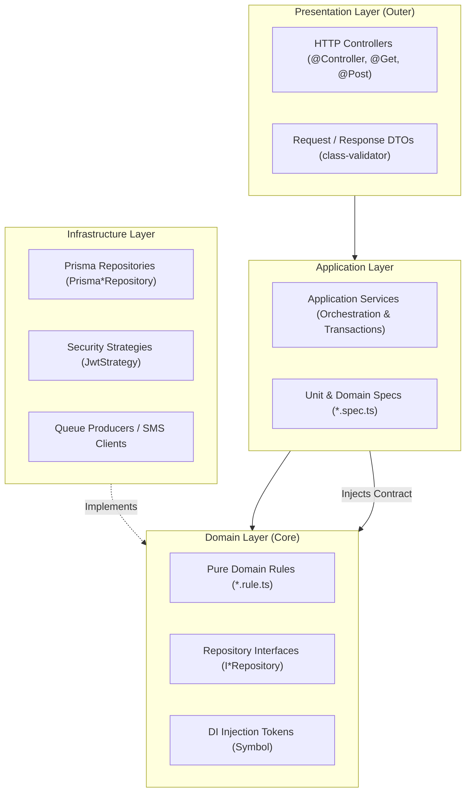

# Domain-Driven Design (DDD) & Clean Architecture Guide

## 1. Architectural Blueprint

Every domain in `apps/backend/src/domains/` follows a standardized 4-layer concentric structure:



---

## 2. Layer Responsibilities & Strict Rules

### 2.1 The Domain Layer (`domain/`)
- **Location:** `apps/backend/src/domains/<domain>/domain/`
- **Key Files:** `rules/<domain>.rule.ts`, `repositories/<domain>.repository.interface.ts`
- **Responsibilities:**
  - Enforces pure business invariants and mathematical equations (e.g. calculation of nights, discounts, interest, overtime wages).
  - Defines the repository interfaces (`IRepository`) and DI tokens (`Symbol('<Token>')`).
- **Strict Rule:** **ZERO external dependencies.** No imports from `@nestjs/*`, `@omnistay/database`, Prisma, or Express. Pure TypeScript and native standard libraries only.

### 2.2 The Application Layer (`application/`)
- **Location:** `apps/backend/src/domains/<domain>/application/`
- **Key Files:** `services/<service>.service.ts`, `services/<service>.spec.ts`
- **Responsibilities:**
  - Coordinates workflows and transactional boundaries.
  - Implements authorization checks (`canManage(caller)`).
  - Interacts with storage strictly through domain repository contracts (`I*Repository`).
  - Emits domain events or enqueues asynchronous jobs.

### 2.3 The Infrastructure Layer (`infrastructure/`)
- **Location:** `apps/backend/src/domains/<domain>/infrastructure/`
- **Key Files:** `repositories/prisma-<domain>.repository.ts`, `strategies/jwt.strategy.ts`
- **Responsibilities:**
  - Implements domain repository interfaces using `PrismaService` (`@omnistay/database`).
  - Manages database relationships, includes, joins, and queries.
  - Declares explicit return types on every method (`: Promise<any>` or explicit DTOs) to prevent `TS2883` unexported type namespace export errors.

### 2.4 The Presentation Layer (`presentation/`)
- **Location:** `apps/backend/src/domains/<domain>/presentation/`
- **Key Files:** `controllers/<controller>.controller.ts`, `dto/<dto>.dto.ts`
- **Responsibilities:**
  - Handles HTTP routing, parameters, status codes, and serialization.
  - Decorates endpoints with OpenAPI 3.1 annotations (`@ApiTags`, `@ApiOperation`, `@ApiResponse`).
  - Applies security guards (`@UseGuards(JwtAuthGuard, RolesGuard)`) and parameter extractors (`@CurrentUser()`).
  - Validates incoming payloads using `class-validator` and `ValidationPipe`.

---

## 3. Dependency Inversion in NestJS Modules

Each domain module (`<domain>.module.ts`) acts as the composition root, binding the abstraction (`I*Repository`) to the concrete implementation (`Prisma*Repository`):

```typescript
import { Module } from '@nestjs/common';
import { PrismaModule } from '@omnistay/database';
import { HOTEL_REPOSITORY_TOKEN } from './domain/repositories/hotel.repository.interface.js';
import { PrismaHotelRepository } from './infrastructure/repositories/prisma-hotel.repository.js';
import { BookingController } from './presentation/controllers/booking.controller.js';
import { BookingService } from './application/services/booking.service.js';

@Module({
  imports: [PrismaModule],
  controllers: [BookingController],
  providers: [
    {
      provide: HOTEL_REPOSITORY_TOKEN,
      useClass: PrismaHotelRepository,
    },
    PrismaHotelRepository,
    BookingService,
  ],
  exports: [HOTEL_REPOSITORY_TOKEN, PrismaHotelRepository, BookingService],
})
export class HotelModule {}
```

---

## 4. Barrel Export Convention (`index.ts`)

Every domain exposes its public API through a root `index.ts`:

```typescript
export * from './hotel.module.js';

// Domain
export * from './domain/rules/hotel.rule.js';
export * from './domain/repositories/hotel.repository.interface.js';

// Infrastructure
export * from './infrastructure/repositories/prisma-hotel.repository.js';

// Application Services
export * from './application/services/booking.service.js';

// Presentation
export * from './presentation/dto/index.js';
export * from './presentation/controllers/booking.controller.js';
```
