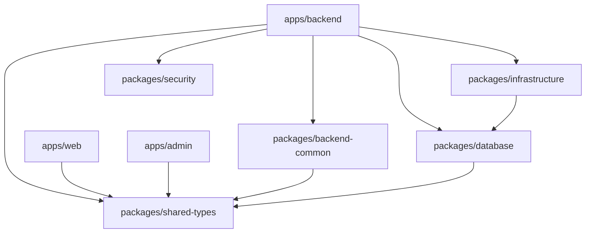

# Monorepo Structure & Package Orchestration

## 1. Monorepo Organization

OmniStay is structured as a **pnpm Workspaces monorepo** with shared library packages and independent applications.

```text
softsasi-omnistay/
├── apps/
│   ├── backend/               # NestJS 12 API Server (Clean DDD Monolith)
│   ├── web/                   # Next.js 16 Customer Portal (React 19)
│   └── admin/                 # Next.js 16 Property Management Console (React 19)
├── packages/
│   ├── database/              # Prisma Client & PostgreSQL Migrations (319+ tables)
│   ├── infrastructure/        # Redis, BullMQ queues, distributed locks, notification workers
│   ├── security/              # Cryptographic AES-256-GCM, TOTP & token utilities
│   ├── backend-common/        # Shared NestJS guards, filters, decorators, and payloads
│   └── shared-types/          # Canonical domain TypeScript interfaces & Enums
├── docs/                      # Enterprise Architecture & Domain Documentation
├── package.json               # Root monorepo workspace configuration
├── pnpm-workspace.yaml        # Workspace package definitions
└── turbo.json                 # Turborepo task pipeline configuration
```

---

## 2. Package Dependency Graph



---

## 3. Package Responsibilities

### `@omnistay/database`
- **Location:** `packages/database`
- **Role:** The single source of truth for the database schema.
- **Prisma Schema Organization:** Uses Prisma multi-file schemas in `prisma/schema/*.prisma`:
  - `iam.prisma`: Users, roles, permissions, memberships, sessions, refresh tokens.
  - `tenancy.prisma`: Organizations, domains, tenant settings, subscription plans.
  - `hospitality.prisma`: Hotels, room types, rooms, rate plans, seasonal rates, folios.
  - `travel-verticals.prisma`: Tours, cars, boats, events, spaces, flights, carts.
  - `pos.prisma`: POS outlets, menus, menu items, orders, kitchen display system (KDS).
  - `inventory.prisma`: Warehouses, products, stock levels, stock transfers, purchase orders.
  - `hrm.prisma`: Employees, departments, attendance records, leaves, payroll.
  - `crm.prisma`: Leads, pipelines, deals, guest activities, interaction logs.
  - `loyalty.prisma`: Loyalty programs, tiers, wallets, transactions, rewards.
  - `marketplace.prisma`: Vendors, vendor listings, payouts, reviews.
  - `accounting.prisma`: USALI chart of accounts, journal entries, AR invoices, AP bills, night audit.

### `@omnistay/infrastructure`
- **Location:** `packages/infrastructure`
- **Role:** High-performance Redis caching, BullMQ job queues, and background processors:
  - `RedisService`: Redis connection pool with automatic fallback in non-production.
  - `NotificationProducer` & `NotificationProcessor`: Asynchronous email and SMS dispatchers.
  - Distributed resource locking for booking reservations and cashier drawer shifts.

### `@omnistay/security`
- **Location:** `packages/security`
- **Role:** Hardened security utilities:
  - `CryptoService`: AES-256-GCM field-level encryption for sensitive secrets and HMAC token hashing.
  - `TotpService`: RFC 6238-compliant Time-Based One-Time Password generation and verification.

### `@omnistay/backend-common`
- **Location:** `packages/backend-common`
- **Role:** Shared runtime NestJS interceptors, decorators, and guards:
  - `@CurrentUser()`: Parameter decorator extracting `AuthenticatedUserPayload`.
  - `@Roles()` & `@Permissions()`: Metadata decorators for declarative access control.
  - `JwtAuthGuard`, `RolesGuard`, `PermissionsGuard`, `TenantGuard`: Enterprise security pipeline.

### `@omnistay/shared-types`
- **Location:** `packages/shared-types`
- **Role:** Pure TypeScript types and interfaces shared seamlessly across backend and frontend clients without bundling server dependencies.

---

## 4. Build & Development Pipeline

```bash
# Install all monorepo dependencies
pnpm install

# Build all workspace packages
pnpm --filter "@omnistay/*" build

# Build backend application
pnpm --filter @omnistay/backend build

# Run complete backend test suite (unit, domain, integration)
pnpm --filter @omnistay/backend test
```
