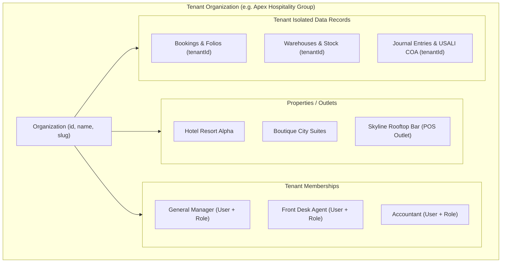

# Multi-Tenancy Architecture & Data Isolation

## 1. Tenancy Model Overview

OmniStay implements a **SaaS Multi-Tenant Architecture** using a shared database with discriminator columns (`tenantId` / `organizationId`) enforced at both the application and database query levels.



---

## 2. Tenancy Hierarchy

1. **Organization (`tenantId`):** The top-level legal entity (hotel management company, enterprise resort group, or property owner).
2. **Property / Hotel (`propertyId`):** Physical lodging properties owned or managed by the organization.
3. **Department / Outlet (`outletId` / `warehouseId`):** Functional divisions within properties, such as restaurant POS outlets, front desk stations, or inventory warehouses.
4. **User & Membership:** A user can exist globally in the platform, but access to a specific tenant is granted solely through a `Membership` record associating the `userId`, `organizationId`, and assigned `roleId`.

---

## 3. Cross-Tenant Isolation Enforcement

### 3.1 Server-Side Query Scoping
Every data mutation or retrieval within an application service or repository automatically applies the caller's verified `tenantId`:

```typescript
// Example: Safe tenant query isolation
async findBookings(organizationId: string, filter: BookingFilterDto) {
  return this.prisma.booking.findMany({
    where: {
      tenantId: organizationId, // Mandatory discriminator
      deletedAt: null,
      ...filter,
    },
  });
}
```

### 3.2 TenantGuard & Request Verification
Incoming HTTP requests carrying organizational route parameters (`/:organizationId`) pass through `TenantGuard`:
- Validates that `caller.organizationId === param.organizationId`.
- SuperAdmins (`isSuperAdmin: true`) possessing `system:root` or `tenant:manage` permissions are permitted to perform administrative audits across tenants.
- Unauthorized attempts to access another tenant's data result in an immediate `403 ForbiddenException ('Cross-tenant access denied')`.

---

## 4. Tenant Provisioning Workflow

When a new organization is registered:
1. An `Organization` record is generated with a unique URL slug (`normalizeSlug(dto.slug)`).
2. A default system role (`Company Owner/GM`) is provisioned for the new tenant with standard administrative permissions.
3. The creator is bound via a `Membership` record with the newly generated `Company Owner/GM` role.
4. The USALI standard Chart of Accounts (COA codes 1010 through 6500) is seeded into the database for the new tenant.
