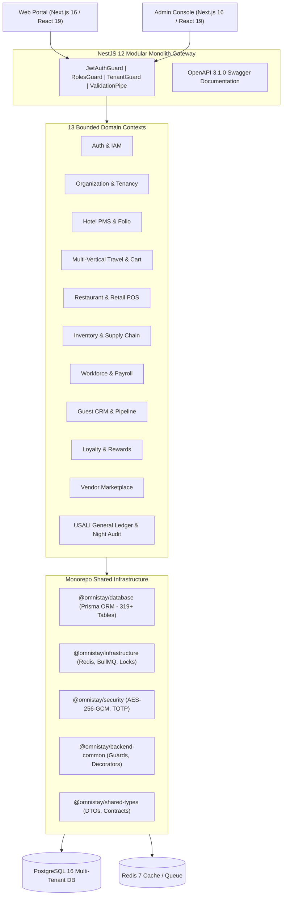

# OmniStay 360 — System Architecture Overview

## 1. Vision & Architecture Philosophy

**OmniStay 360** is an enterprise-grade hospitality, property rental, and travel commerce platform designed as a **Domain-Driven Modular Monolith**. It unifies diverse hospitality verticals (Hotels, Vacation Rentals, Boats, Event Venues, Car Rentals, and Flights) with end-to-end operational engines (PMS, POS, Inventory, HRM, CRM, Loyalty, Marketplace, and USALI-compliant Accounting).

---

## 2. Core Architectural Pillars

### 2.1 Bounded Domain Modularity
- Each domain operates as an autonomous, self-contained module within `apps/backend/src/domains/`.
- **Zero Cross-Domain Dependencies:** Domains do not directly import classes, services, or internal state from other domains. Inter-module communication occurs via published contracts in shared packages or transactional event queues.

### 2.2 Clean Architecture & Hexagonal Boundaries
Each domain adheres strictly to the 4 Clean Architecture concentric rings:
1. **Domain Layer:** Pure mathematical rules, domain entities, value objects, and repository interfaces. Contains zero imports from NestJS, Prisma, Express, or external I/O.
2. **Application Layer:** Application use cases, service orchestration, event dispatching, and transaction boundaries.
3. **Infrastructure Layer:** Database adapters (`Prisma*Repository`), external message producers, and passport security strategies implementing the domain repository interfaces.
4. **Presentation Layer:** NestJS HTTP controllers, OpenAPI annotations, route guards, and class-validator DTOs.

### 2.3 Strict Multi-Tenancy by Design
- Every commercial record (bookings, folios, inventory items, employees, ledger entries) is partitioned by `tenantId` (mapped to `Organization`).
- Strict server-side verification prevents cross-tenant data leaks at the database query level.

---

## 3. Technology Stack

| Component | Technology | Version | Purpose |
| :--- | :--- | :--- | :--- |
| **Runtime Environment** | Node.js | v20+ / v22 LTS | Enterprise asynchronous server runtime |
| **Package Management** | pnpm | v10+ (Workspaces) | Fast, deterministic monorepo dependency management |
| **Backend Framework** | NestJS | 12.x | Modular dependency injection, routing, guards, and decorators |
| **Database ORM** | Prisma ORM | 6.x | Schema-driven migrations, type-safe PostgreSQL client (319+ tables) |
| **Relational Database** | PostgreSQL | 16+ | ACID-compliant relational persistence with UUID keys |
| **In-Memory Store & Queues**| Redis & BullMQ | Redis 7, BullMQ 5.x | Distributed rate limiting, async job queues, locking |
| **Security & Crypto** | Node `crypto`, `bcryptjs`, `otplib` | Native / Standard | AES-256-GCM encryption, TOTP 2FA, argon/bcrypt password hashing |
| **API Specification** | OpenAPI / Swagger | 3.1.0 | Rich interactive documentation, schema validation |
| **Test Framework** | Vitest | 4.x | Blazing fast ESM unit, domain, and integration test execution |

---

## 4. Architectural Decision Records (ADRs) Summary

- **ADR-001 (Modular Monolith over Microservices):** OmniStay adopts a modular monolith inside a pnpm monorepo. This eliminates distributed transaction complexities (e.g. 2PC across hotel booking and accounting folios) while maintaining crystal-clear domain boundaries.
- **ADR-002 (Prisma Repositories with Explicit Return Types):** All repository implementations declare explicit TypeScript return types (`: Promise<any>` or explicit domain contracts) to bypass compiler namespace generation issues (`TS2883`) during Nest build.
- **ADR-003 (Domain Rules Purity):** Complex business formulas (e.g. Haversine distance for attendance, double-entry trial balance checking, vacation cart bundle discounts) are extracted into standalone pure functions under `domain/rules/*.rule.ts`, allowing instant, zero-mock testing.
