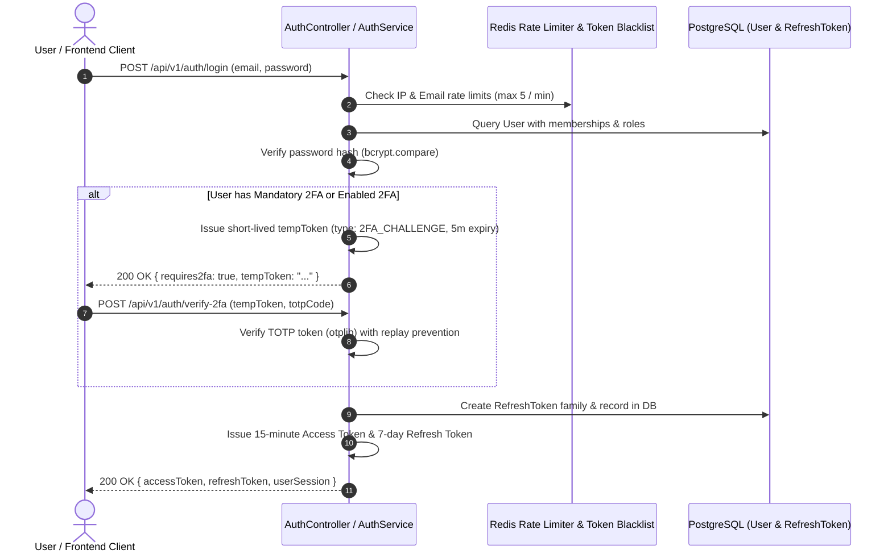

# Security, Authentication & 10 Personas RBAC

## 1. Authentication Pipeline

The authentication subsystem in `apps/backend/src/domains/auth` is hardened with multi-factor authentication, cryptographic token rotation, and distributed rate limiting.



---

## 2. The 10 Personas / Roles RBAC Matrix

OmniStay defines 10 core personas spanning platform administrators, tenant operators, staff, and guests:

| # | Persona / Role Name | Scope | Mandatory 2FA | Key Permissions & Responsibilities |
| :-: | :--- | :--- | :-: | :--- |
| 1 | **SuperAdmin / Platform SuperAdmin** | Global Platform | **Yes** | `system:root`, `tenant:manage`, `tenant:create`, full cross-tenant audit |
| 2 | **Company Owner / GM** | Tenant Organization | **Yes** | Full operational control of properties, rooms, staff, rates, financials |
| 3 | **General Manager (GM)** | Property | **Yes** | Property operations, rate strategy, staff scheduling, revenue monitoring |
| 4 | **Front Desk Agent** | Property | No | Check-ins, check-outs, reservations, guest folios, room allocation |
| 5 | **Housekeeping Staff** | Property | No | Room status updates (clean, dirty, inspecting), task checklist |
| 6 | **Maintenance Technician** | Property | No | Work order execution, HVAC/equipment repairs, SLA tickets |
| 7 | **Restaurant / POS Cashier** | Outlet | No | Dine-in orders, KDS ticket dispatch, cash drawer opening/closing |
| 8 | **Chief Financial Officer / Accountant** | Tenant Organization | **Yes** | General ledger, journal entries, AR billing, AP bills, night audit |
| 9 | **Third-Party Vendor / Host** | Vendor / Space | No | Car, boat, tour, and marketplace listings, inventory sync, payouts |
| 10 | **Hotel Guest / Traveler** | Personal Scope | No | Personal reservations, travel cart bookings, loyalty points redemption |

---

## 3. Mandatory 2FA Enforcement

For high-privilege roles, 2FA is **strictly non-optional**:
```typescript
export const MANDATORY_2FA_ROLES = [
  'SuperAdmin',
  'Platform SuperAdmin',
  'Company Owner/GM',
  'Company Owner / GM',
  'General Manager (GM)',
  'Financial Accountant',
  'Chief Financial Officer / Accountant',
];
```
- Users holding these roles cannot disable 2FA via the API (`403 ForbiddenException: '2FA cannot be disabled for your administrative role'`).
- Purpose-restriction: `2FA_CHALLENGE` tokens cannot be used to authenticate protected API routes.

---

## 4. Refresh Token Rotation & Compromise Detection

- Refresh tokens are issued within cryptographic **Token Families** (`familyId`).
- Each refresh operation revokes the current token and issues a new active token.
- **Compromise Detection:** If an already revoked refresh token is presented, the system flags token reuse, marks all tokens in the family as compromised, and revokes access across all active devices.
