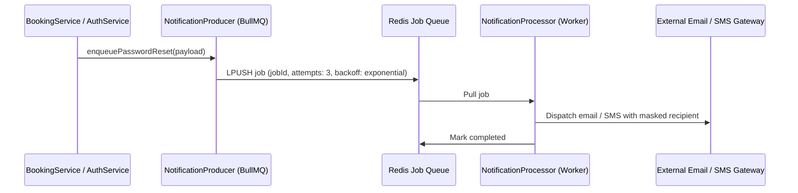

# Redis Infrastructure, Distributed Locks & BullMQ Queues

## 1. Redis Overview

OmniStay relies on **Redis 7** for:
1. **Distributed Rate Limiting:** Brute-force protection on authentication routes.
2. **Asynchronous Background Processing:** BullMQ queues for transactional emails and SMS.
3. **Distributed Resource Locking:** Preventing double-bookings and race conditions during simultaneous checkouts.
4. **Resilient Fallback:** When Redis is unavailable in local development or test environments, `RedisService` and `RateLimiterService` automatically degrade gracefully to in-memory storage, while enforcing strict fail-closed security in production.

---

## 2. Distributed Rate Limiting

The `RateLimiterService` enforces token-bucket / sliding-window limits:

```typescript
// Enforce max 5 login attempts per minute per IP + email
const rateLimitKey = `login:${ip}:${dto.email.toLowerCase()}`;
await this.rateLimiter.consume(rateLimitKey, 5, 60000);
```

- In production (`NODE_ENV === 'production'`), if Redis drops connection, rate limiting operates in **Fail-Closed Mode** (`503 Service Unavailable`) to prevent brute-force exploitation.
- In test and development environments, it falls back to an internal `Map` with timed eviction.

---

## 3. BullMQ Queues & Notification Workers

Asynchronous jobs are routed through BullMQ queues managed by `@omnistay/infrastructure`:



Supported job types:
- `JOB_NAMES.TWO_FACTOR_ALERT`: High-priority SMS with 6-digit OTP verification code.
- `JOB_NAMES.PASSWORD_RESET`: Password reset link with masked recipient logs (`j***e@domain.com`).
- `JOB_NAMES.BOOKING_CONFIRMATION`: Asynchronous PDF voucher generation and email receipt.
