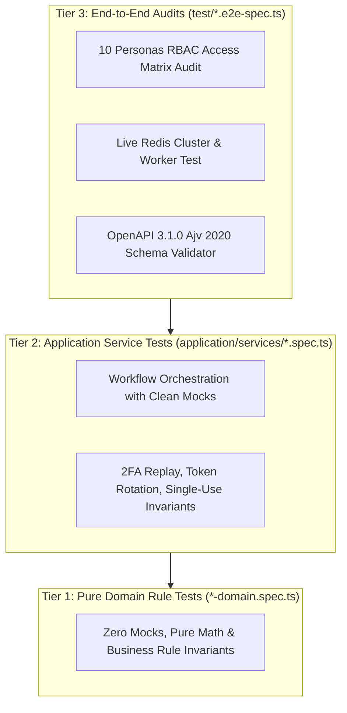

# Testing Strategy & Guidelines

## 1. Testing Philosophy

OmniStay enforces a **3-tier testing pyramid** built on **Vitest 4**:



---

## 2. Tier 1: Pure Domain Rule Tests (`*-domain.spec.ts`)
- **Location:** In-domain root, e.g. `apps/backend/src/domains/hotel/hotel-domain.spec.ts`.
- **Characteristics:**
  - **Zero external dependencies and zero mocks.**
  - Tests pure mathematical equations, tax algorithms, bundle discounts, double-entry trial balance reconciliation, Haversine GPS geofence checks, and barcode checksums.
  - Executes in sub-milliseconds.

---

## 3. Tier 2: Application Service Tests (`*.spec.ts`)
- **Location:** `application/services/<service>.spec.ts`.
- **Characteristics:**
  - Mocks the repository interface or `PrismaService`.
  - Tests transactional flows, authorization checks (`canManage`), and lifecycle updates.

---

## 4. Tier 3: End-to-End Audits (`test/*.e2e-spec.ts`)
- **Location:** `apps/backend/test/`.
- **Test Suites:**
  - `test/rbac-10-roles-audit.e2e-spec.ts`: Executes a complete security audit verifying that each of the 10 defined personas can access only permitted endpoints and is denied cross-tenant or unauthorized routes.
  - `test/redis-live.spec.ts`: Tests BullMQ worker retries and rate limiter fallback behavior.
  - `src/setup-swagger.spec.ts`: Validates that generated OpenAPI 3.1.0 schemas pass strict JSON Schema 2020-12 validation via Ajv.

---

## 5. Running Tests

```bash
# Run all backend tests
pnpm --filter @omnistay/backend test

# Run tests for a specific domain
pnpm --filter @omnistay/backend test src/domains/hotel

# Run tests in watch mode
pnpm --filter @omnistay/backend test:watch

# Generate test coverage report
pnpm --filter @omnistay/backend test:cov
```
