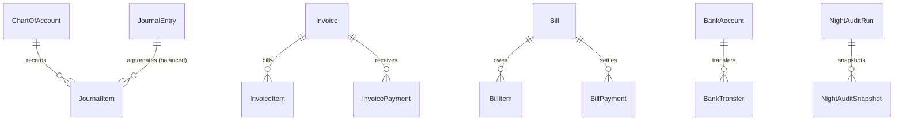

# USALI General Ledger & Night Audit Domain Model

## 1. Bounded Context Overview

The **Accounting Domain** (`apps/backend/src/domains/accounting`) implements the Uniform System of Accounts for the Lodging Industry (**USALI**) double-entry general ledger, Accounts Receivable (AR), Accounts Payable (AP), Bank/Treasury transfers, Cash Register drawer management, and automated Night Audit execution.



---

## 2. Standard USALI Chart of Accounts (COA)

Every tenant organization is seeded with standardized 4-digit USALI accounts:
- **1000 - 1999 (Assets):**
  - `1010`: Cash & Operating Bank Accounts
  - `1020`: Petty Cash & Front Desk Float
  - `1100`: Guest Folios Accounts Receivable
  - `1110`: City Ledger / Corporate Accounts Receivable
  - `1200`: Food & Beverage Inventory
  - `1210`: Guest Supplies & Operating Inventory
- **2000 - 2999 (Liabilities):**
  - `2010`: Accounts Payable - Trade Creditors
  - `2100`: Unearned Advance Bookings & Guest Deposits
  - `2200`: Sales Tax & VAT Payable
  - `2250`: City Lodging & Tourism Tax Payable
- **3000 - 3999 (Equity):**
  - `3010`: Contributed Capital
  - `3020`: Retained Earnings
- **4000 - 4999 (Revenue):**
  - `4010`: Room Revenue - Transient
  - `4020`: Room Revenue - Corporate & Groups
  - `4100`: Food Sales - Restaurants & Room Service
  - `4150`: Beverage Sales - Bars & Lounges
  - `4200`: Spa, Wellness & Recreation Revenue
  - `4300`: Tour, Travel & Excursion Commissions
- **5000 - 6999 (Expenses & COGS):**
  - `5010`: Cost of Raw Food Ingredients
  - `5020`: Cost of Beverage & Alcohol Inventory
  - `6010`: Front Desk & Administrative Salaries
  - `6020`: Housekeeping Wages
  - `6100`: Utilities - Electricity, Water & Gas
  - `6200`: Maintenance & Repairs

---

## 3. Pure Domain Rules (`domain/rules/accounting.rule.ts`)

### 3.1 Strict Double-Entry Ledger Invariant
- **Minimum 2 Line Items:** Requires at least one debit and one credit.
- **Single Direction Line:** A line item cannot have both debit > 0 and credit > 0.
- **Mathematical Balance:** `Total Debits === Total Credits` (checked with 2-decimal currency precision).

```typescript
export function validateDoubleEntryJournal(items: JournalItemValidationInput[]): JournalValidationResult {
  if (!items || items.length < 2) return { isValid: false, error: 'A double-entry journal requires at least two line items' };
  let totalDebit = 0, totalCredit = 0;
  for (const item of items) {
    if (item.debit > 0 && item.credit > 0) return { isValid: false, error: 'A single journal line cannot have both Debit and Credit' };
    totalDebit += item.debit || 0;
    totalCredit += item.credit || 0;
  }
  totalDebit = Math.round(totalDebit * 100) / 100;
  totalCredit = Math.round(totalCredit * 100) / 100;
  if (totalDebit !== totalCredit) return { isValid: false, totalDebit, totalCredit, error: 'Double-entry imbalance' };
  return { isValid: true, totalDebit, totalCredit };
}
```

### 3.2 Automated Night Audit Daemon
The Night Audit process executes at the end of each hospitality day:
1. Scans occupied in-house reservations for the audit date.
2. Posts room charge accruals:
   - Debit: `1100` Guest Folios Accounts Receivable
   - Credit: `4010` Room Revenue - Transient
   - Credit: `2250` City Lodging Tax Payable
3. Releases unearned advance booking deposits (`2100` -> `4010`).
4. Reconciles trial balance variance to zero.
5. Saves snapshot record in `NightAuditRun`.

---

## 4. Repository Contract (`IAccountingRepository`)

Implemented by `PrismaAccountingRepository`:
- **Chart of Accounts:** `findAccounts`, `findAccountById`, `findAccountByCode`, `createAccount`, `updateAccount`.
- **Journal:** `findJournalEntries`, `findJournalEntryById`, `createJournalEntry`.
- **AR / AP:** `findInvoices`, `createInvoice`, `findBills`, `createBill`, `createBillPayment`.
- **Treasury:** `findBankAccounts`, `createBankTransfer`, `createCashRegisterShift`, `updateCashRegisterShift`.
- **Audit:** `findNightAuditRuns`, `findNightAuditRunByDate`, `createNightAuditRun`.
