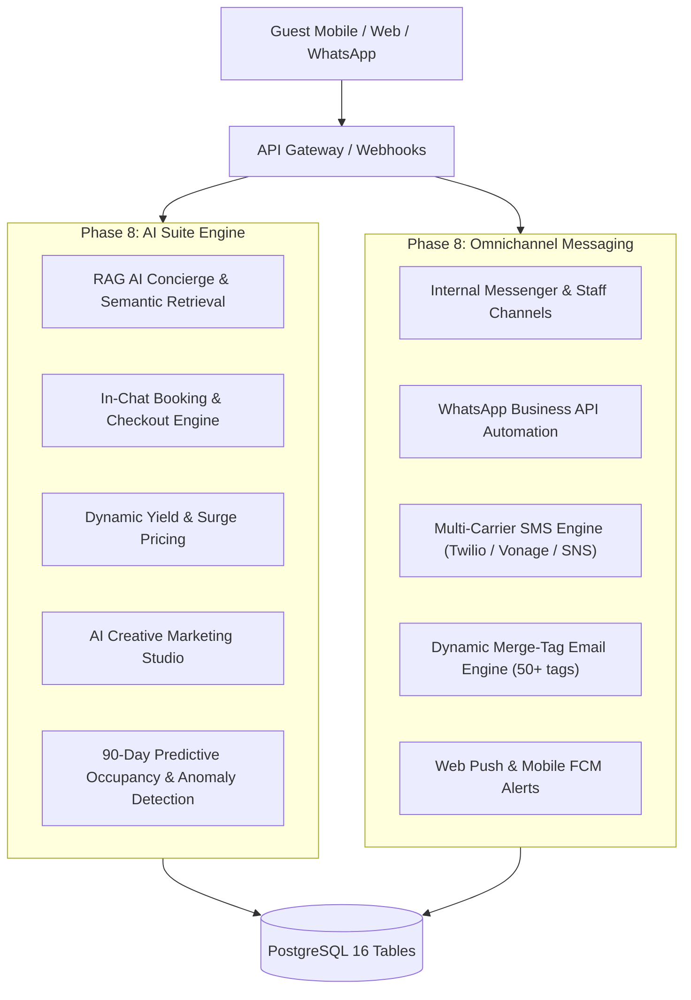

# Phase 8: AI Suite & Omnichannel Communications Domain Model

## 1. Bounded Context Overview

The **AI Suite & Omnichannel Communications Context** (`apps/backend/src/domains/ai` and `apps/backend/src/domains/communication`) fulfills **Phase 8** of the Softsasi OmniStay 360 Enterprise Master Blueprint. It delivers 24/7 autonomous guest intelligence, in-chat commerce, dynamic yield pricing, marketing copywriting, predictive analytics, and multi-carrier messaging infrastructure.

---

## 2. AI Suite Specifications (`apps/backend/src/domains/ai`)

### 2.1 Autonomous RAG AI Guest Concierge
- **Vector & Semantic Retrieval:** Ingests property knowledge documents (amenities, policies, local attractions, dining menus) into `ai_knowledge_documents` and `ai_knowledge_embeddings`.
- **Multilingual Intent Classification:** Native support for 50+ languages with automated detection (Bengali, Spanish, Arabic, French, German, Japanese, Chinese, English).
- **Intent Taxonomy:**
  - `booking_inquiry`: Dates, room availability, occupancy.
  - `room_recommendation`: Tailored suggestions (toddler-friendly, quiet acoustics, elevator access, ocean views).
  - `amenity_query`: Wi-Fi credentials, pool hours, spa treatments.
  - `dining_order`: Room service menus and guest room folio charging.
  - `checkout_payment`: Immediate in-chat settlement.

### 2.2 Conversational In-Chat Booking & Commerce
- **Zero Redirection:** Eliminates checkout abandonment by initiating and confirming bookings directly within the chat bubble.
- Generates secure reservation tokens (`tok_inchat_*`) and records transactional receipts in `ai_in_chat_transactions`.

### 2.3 Dynamic Yield & Revenue Management
- **Surge Pricing Rules:**
  - Occupancy $\ge 90\%$: $+25\%$ surge multiplier.
  - Occupancy $80\% - 89\%$: $+15\%$ surge multiplier.
  - Occupancy $70\% - 79\%$: $+5\%$ surge multiplier.
- **Tactical Last-Minute Promotion:** Decrements rates by $-15\%$ when arrival is within 48 hours and occupancy is $<60\%$.
- **Competitor Rate Calibration:** Benchmarks rates against 5-mile radius competitor hotel averages to cap premiums at $+10\%$.

### 2.4 AI Marketing Studio & Predictive Analytics
- **Tone Personalization:** Automated copywriting generation with tones (`Luxury`, `Romantic`, `Family`, `Business`) for Email, SMS, and SEO metadata.
- **90-Day Forecasting:** Combines confirmed booking velocity with historical occupancy to project RevPAR.
- **Expense Anomaly Detection:** Flags departmental expenditures exceeding historical baseline thresholds ($>1.5\times$).

---

## 3. Omnichannel Communications (`apps/backend/src/domains/communication`)

### 3.1 Real-Time Chat & Staff Channels
- **Direct & Group Messaging:** 1-to-1 guest-to-front desk messaging and dedicated operational staff channels (`#FrontDesk-Housekeeping`, `#Maintenance-Emergency`).
- Message sanitization prevents XSS and malicious script injection.

### 3.2 WhatsApp Business API
- **Transactional Triggers:** Automated triggers for Booking Confirmations, Pre-Arrival Check-in links, Room Ready alerts, and Digital Folio receipts.
- **Webhook Security:** Validates inbound webhooks using HMAC-SHA256 (`X-Softsasi-Signature`).

### 3.3 High-Delivery SMS Gateways
- Multi-carrier aggregation supporting Twilio, Vonage, and AWS SNS.
- Dedicated routing for critical OTPs and smart lock PIN codes.

### 3.4 Dynamic Email Template & Campaign Styler
- **Merge Tag Engine:** Resolves 50+ variables (`{guest_name}`, `{property_name}`, `{check_in_date}`, `{total_amount}`, `{booking_code}`).
- Automated campaign scheduling and delivery audit tracking.

---

## 4. API Endpoints Summary

### AI Suite
- `POST /api/v1/ai/concierge/chat` — Conversational query to RAG concierge.
- `GET /api/v1/ai/concierge/history/:sessionId` — Retrieve conversation thread.
- `POST /api/v1/ai/concierge/knowledge` — Index new property knowledge document.
- `POST /api/v1/ai/in-chat/initiate` — Initiate conversational room booking.
- `POST /api/v1/ai/in-chat/confirm/:transactionId` — Confirm in-chat payment.
- `POST /api/v1/ai/pricing/evaluate` — Real-time yield pricing calculation.
- `POST /api/v1/ai/marketing/generate-copy` — Generate marketing copywriting.
- `POST /api/v1/ai/predictive/forecast` — Compute 90-day predictive forecast.

### Omnichannel Messaging
- `POST /api/v1/communications/chat/messages` — Send direct or channel message.
- `POST /api/v1/communications/chat/channels` — Create staff operational channel.
- `POST /api/v1/communications/whatsapp/send` — Send transactional WhatsApp message.
- `POST /api/v1/communications/whatsapp/webhook` — Inbound WhatsApp webhook.
- `POST /api/v1/communications/sms/send` — Dispatch SMS or critical OTP.
- `POST /api/v1/communications/email/templates` — Register dynamic email template.
- `POST /api/v1/communications/email/render` — Compile template with merge variables.
- `POST /api/v1/communications/push/subscribe` — Register Web Push / FCM device subscription.
