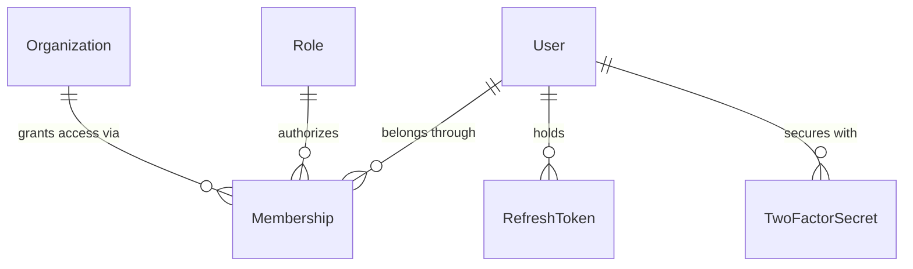

# Identity, Access Management (IAM) & Tenancy Domain Model

## 1. Bounded Context Overview

The **Auth, User & Organization Domains** (`auth/`, `user/`, `organization/`) manage global identity, multi-tenant organizations, membership role bindings, session token lifecycles, and security compliance.

---

## 2. Core Domain Rules (`domain/rules/auth.rule.ts` & `organization.rule.ts`)

### 2.1 Mandatory 2FA Guard
- Identifies administrative personas that are strictly required to use TOTP two-factor authentication:
  - `SuperAdmin`, `Platform SuperAdmin`, `Company Owner/GM`, `General Manager (GM)`, `Financial Accountant`, `Chief Financial Officer / Accountant`.
- Prevents 2FA deactivation for mandatory personas.

### 2.2 Token Cryptography
- Generates 256-bit cryptographically secure entropy tokens (`generateSecureToken(32)`).
- Hashes refresh tokens and reset tokens with SHA-256 (`hashToken(token)`).

### 2.3 Tenant Slug Normalization
- Converts user-entered organization names into URL-safe, lowercase, alphanumeric slugs (`normalizeSlug(raw)`).

---

## 3. Repository Contracts

- `IAuthRepository`: `findUserByEmail`, `findUserById`, `createRefreshToken`, `findRefreshToken`, `revokeRefreshToken`.
- `IUserRepository`: `findProfileById`, `updateUser`, `findTenantMemberships`.
- `IOrganizationRepository`: `findUserMemberships`, `findOrganizationById`, `findOrganizationBySlug`, `createOrganizationWithDefaults`.
