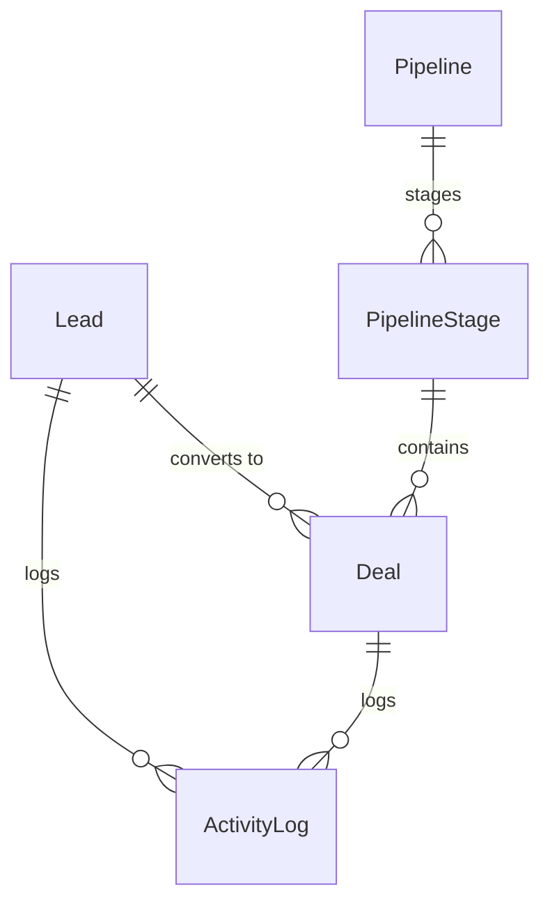

# Guest CRM & Sales Pipeline Domain Model

## 1. Bounded Context Overview

The **CRM Domain** (`apps/backend/src/domains/crm`) manages corporate accounts, high-net-worth guest relationships, sales pipelines, deals, automated lead scoring, and touchpoint activity histories.

---

## 2. Core Domain Rules (`domain/rules/crm.rule.ts`)

### 2.1 Predictive Lead Scoring
- Evaluates inbound corporate and travel leads based on:
  - Budget size (>$10,000 gives +30 points)
  - Timeframe immediacy (within 30 days gives +20 points)
  - Authority (Director/VP gives +25 points)
  - Activity engagement (email opens, calls logged)
- Assigns lead quality tier: `hot` (80+), `warm` (50-79), `cold` (<50).

### 2.2 Weighted Pipeline Revenue Forecast
- Calculates weighted pipeline value: `Expected Revenue = Deal Value * Stage Probability (%)`.

---

## 3. Repository Contract (`ICrmRepository`)

Implemented by `PrismaCrmRepository`:
- **Leads:** `findLeads`, `findLeadById`, `createLead`, `updateLead`.
- **Pipelines & Deals:** `findPipelines`, `findDeals`, `createDeal`, `updateDealStage`.
- **Activities:** `findActivities`, `createActivity`.
