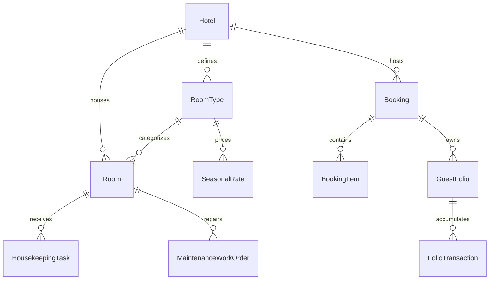

# Hotel PMS & Hospitality Domain Model

## 1. Bounded Context Overview

The **Hotel Domain** (`apps/backend/src/domains/hotel`) represents the Property Management System (PMS) core of OmniStay 360. It handles rooms, room types, rate plans, daily pricing calendars, guest reservations, multi-department guest folios, housekeeping schedules, maintenance tickets, tape-chart visual grids, and external OTA iCal synchronization.

---

## 2. Core Domain Entities & Aggregates

### 2.1 Booking Aggregate
- **Root:** `Booking` (id, bookingCode, propertyId, guestId, status, checkInDate, checkOutDate, totalAmount)
- **Invariants:**
  - `checkOutDate` must be strictly after `checkInDate`.
  - Room nights must be continuous.
  - Automatically initializes an open `GuestFolio` upon reservation creation.

### 2.2 GuestFolio & FolioTransaction
- Handles multi-department guest billing (room charges, restaurant POS charges, spa, minibar).
- Invariant: `balanceDue = totalCharges - totalPayments`.

### 2.3 Tape Chart Grid & Visual Matrix
- Provides a 2D matrix (Rooms × Days) showing occupancy status: `vacant`, `reserved`, `occupied`, `maintenance`, `cleaning`.

---

## 3. Pure Domain Rules (`domain/rules/hotel.rule.ts`)

| Pure Rule Function | Business Responsibility |
| :--- | :--- |
| `generateBookingCode(prefix = 'BK')` | Generates unique reservation codes (e.g. `BK-A1B2C34567`). |
| `calculateBookingNightsAndTotals(checkIn, checkOut, basePrice, taxes, deposit)` | Validates dates, calculates nights, line totals, subtotal, and remaining balance due. |
| `calculateFolioBalance(charges, payments)` | Accurately calculates guest folio remaining balance due. |
| `calculateMaintenanceSla(priority, reportedAt)` | Computes SLA resolution target deadlines based on ticket priority (`critical`, `high`, `medium`, `low`). |

---

## 4. Repository Contract (`IHotelRepository`)

Decoupled contract implemented by `PrismaHotelRepository`:
- **Hotel Operations:** `findHotels`, `findHotelById`, `findHotelByCode`, `createHotel`, `updateHotel`.
- **Inventory & Pricing:** `findRoomTypes`, `findRooms`, `findRatePlans`, `findDailyRates`, `upsertDailyRate`.
- **Bookings & Folios:** `createBooking`, `findBookingById`, `findBookingByCode`, `findBookings`, `findFolioById`, `createFolioTransaction`.
- **Operations:** `findHousekeepingTasks`, `createHousekeepingTask`, `findMaintenanceTickets`, `createMaintenanceTicket`, `findIcalFeeds`.

---

## 5. API Presentation Endpoints

- `POST /api/v1/hotel/bookings` — Create reservation & auto-initialize guest folio
- `GET /api/v1/hotel/bookings/:id` — View reservation details
- `POST /api/v1/hotel/bookings/:id/check-in` — Check in guest and assign physical room
- `POST /api/v1/hotel/bookings/:id/check-out` — Settle folio balance and check out
- `GET /api/v1/hotel/tape-chart` — Real-time tape chart matrix
- `GET /api/v1/hotel/ical/:roomTypeId/feed.ics` — Live iCal calendar synchronization
