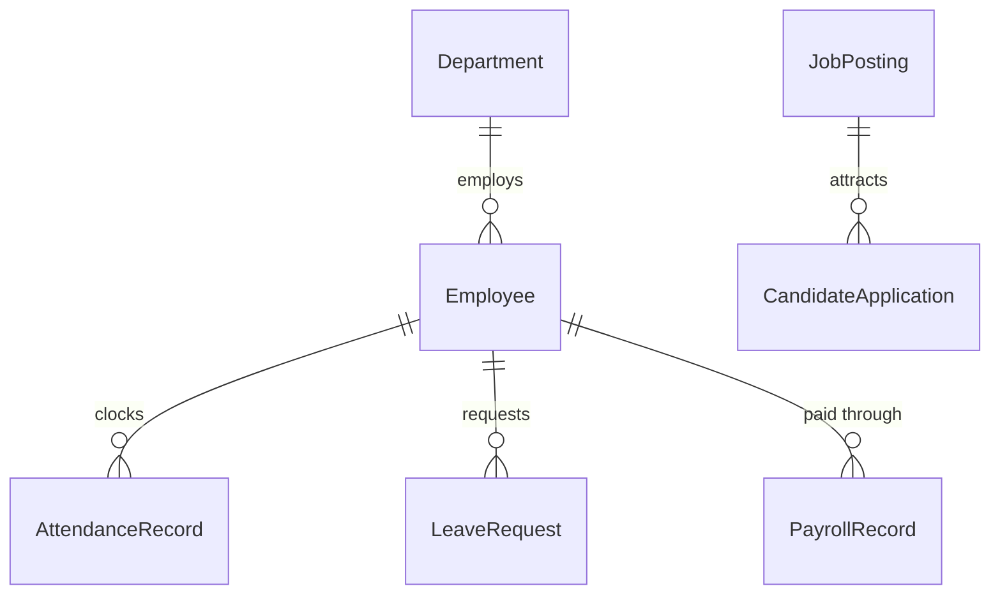

# Human Resources & Workforce (HRM) Domain Model

## 1. Bounded Context Overview

The **HRM Domain** (`apps/backend/src/domains/hrm`) manages employee profiles, organizational departments, GPS geofenced mobile attendance tracking, statutory leave accrual, recruitment pipelines, and automated monthly payroll calculation.

---

## 2. Core Domain Rules (`domain/rules/hrm.rule.ts`)

### 2.1 Haversine GPS Geofence Verification
- Uses the Haversine spherical equation to compute the distance in meters between the employee's mobile punch coordinates and the property's designated GPS centroid.
- Enforces property geofence radius (e.g. 150m): punches outside the radius are flagged or rejected.

### 2.2 Worked Hours & Overtime Invariants
- Calculates total worked hours between check-in and check-out timestamps.
- Daily threshold: Hours worked beyond 8.0 hours are classified as overtime (1.5x standard hourly rate).

### 2.3 Payroll Net Salary Calculation
- `Gross Earnings = Base Salary + Overtime Pay + Allowances + Bonuses`.
- `Total Deductions = Tax Withholding + Provident Fund / Social Security + Health Insurance`.
- `Net Salary = Gross Earnings - Total Deductions`.

### 2.4 Peak Holiday Blackout Enforcement
- Prevents staff leave during high-occupancy blackout periods (New Year's Eve, Peak Festival Dates).

---

## 3. Repository Contract (`IHrmRepository`)

Implemented by `PrismaHrmRepository`:
- **Employees:** `findEmployees`, `findEmployeeById`, `createEmployee`, `updateEmployee`.
- **Attendance:** `findAttendance`, `createAttendancePunch`, `updateAttendancePunch`.
- **Leaves:** `findLeaveRequests`, `createLeaveRequest`, `updateLeaveStatus`.
- **Payroll:** `findPayrollRuns`, `createPayrollSlip`.
