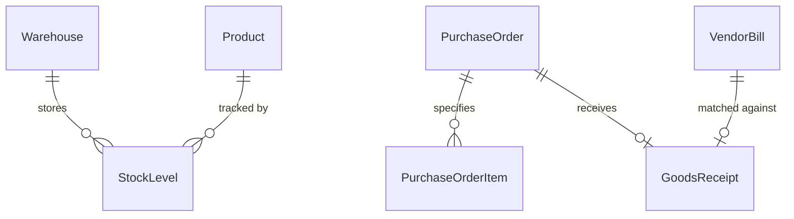

# Inventory & Procurement Domain Model

## 1. Bounded Context Overview

The **Inventory Domain** (`apps/backend/src/domains/inventory`) provides real-time multi-warehouse stock management, product cataloging with EAN-13 barcodes, inventory valuation under FIFO / Moving Average Cost (AVCO), supplier purchase orders, and automated 3-way invoice matching.

---

## 2. Core Domain Rules (`domain/rules/inventory.rule.ts`)

### 2.1 EAN-13 Checksum Calculation
- Generates compliant 13-digit retail barcodes.
- Modulo 10 checksum algorithm ensures barcode scanning integrity.

### 2.2 Inventory Valuation
- Calculates asset value under:
  - **FIFO (First-In, First-Out):** Depletes earliest batch unit costs first.
  - **AVCO (Average Cost):** Dynamically updates weighted average unit cost on every goods receipt.

### 2.3 3-Way Match Verification
- Validates **Purchase Order (PO)**, **Goods Receipt Note (GRN)**, and **Vendor Bill**:
  - Quantity invoiced must equal quantity inspected and received.
  - Unit price invoiced must not exceed agreed PO purchase price.
  - Returns `verified_3_way_matched` or flags discrepancies before payment release.

---

## 3. Repository Contract (`IInventoryRepository`)

Implemented by `PrismaInventoryRepository`:
- **Warehouses & Stock:** `findWarehouses`, `findProducts`, `findStockLevels`, `updateStockLevel`.
- **Procurement:** `findPurchaseOrders`, `createPurchaseOrder`, `updatePurchaseOrderStatus`.
- **Valuation:** `calculateValuation`, `findStockAudits`.
