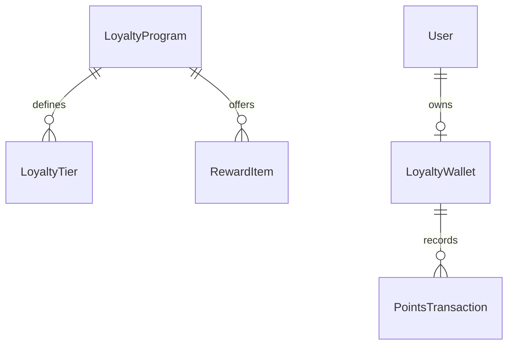

# Guest Loyalty & Rewards Domain Model

## 1. Bounded Context Overview

The **Loyalty Domain** (`apps/backend/src/domains/loyalty`) drives traveler retention through points-earning wallets, tier progression thresholds (Bronze, Silver, Gold, Platinum), promotional campaigns, and reward redemptions.

---

## 2. Core Domain Rules (`domain/rules/loyalty.rule.ts`)

### 2.1 Points Accrual & Burn Rates
- **Accrual:** Standard earn rate (e.g. 10 points per $1 spent on room bookings, dining, and travel).
- **Burn:** Redemption rate (e.g. 100 points = $1 checkout credit).
- Enforces wallet balance sufficiency: `wallet.currentPoints >= pointsToRedeem`.

### 2.2 Tier Progression Thresholds
- Automatically promotes members when cumulative tier points meet qualification thresholds:
  - Bronze: 0 - 999 points (1.0x multiplier)
  - Silver: 1,000 - 4,999 points (1.2x multiplier)
  - Gold: 5,000 - 9,999 points (1.5x multiplier)
  - Platinum: 10,000+ points (2.0x multiplier)

---

## 3. Repository Contract (`ILoyaltyRepository`)

Implemented by `PrismaLoyaltyRepository`:
- **Wallets:** `findWalletByUserId`, `createWallet`, `updateWalletBalance`.
- **Transactions:** `createPointsTransaction`, `findTransactionsByWallet`.
- **Tiers & Rewards:** `findTiers`, `findRewards`, `redeemReward`.
