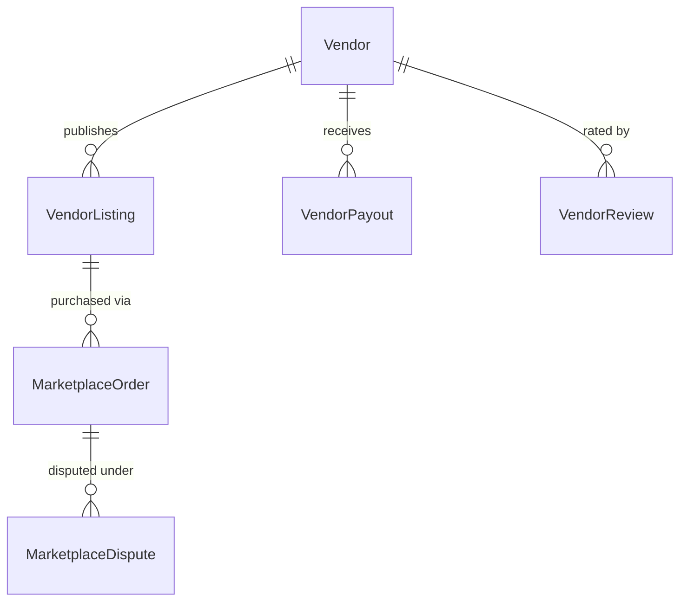

# Vendor Marketplace & Multi-Vendor Payouts Domain Model

## 1. Bounded Context Overview

The **Marketplace Domain** (`apps/backend/src/domains/marketplace`) enables third-party vendors and local hosts to list ancillary travel services (airport transfers, private tour guides, rental equipment, spa sessions) on the OmniStay booking platform.

---

## 2. Core Domain Rules (`domain/rules/marketplace.rule.ts`)

### 2.1 Multi-Vendor Commission Split
- Calculates platform commission (e.g. 15% standard take rate).
- Invariant: `Net Payout Amount = Gross Order Value - Platform Commission - Processing Fees`.

### 2.2 Escrow & Payout Hold Periods
- Enforces payout release windows (e.g. 48 hours post-checkout/completion) to allow guest dispute reviews before funds are disbursed.

---

## 3. Repository Contract (`IMarketplaceRepository`)

Implemented by `PrismaMarketplaceRepository`:
- **Vendors:** `findVendors`, `findVendorById`, `createVendor`, `updateVendor`.
- **Listings:** `findListings`, `createListing`, `updateListingStatus`.
- **Payouts & Escrow:** `findPayouts`, `createPayout`, `updatePayoutStatus`.
