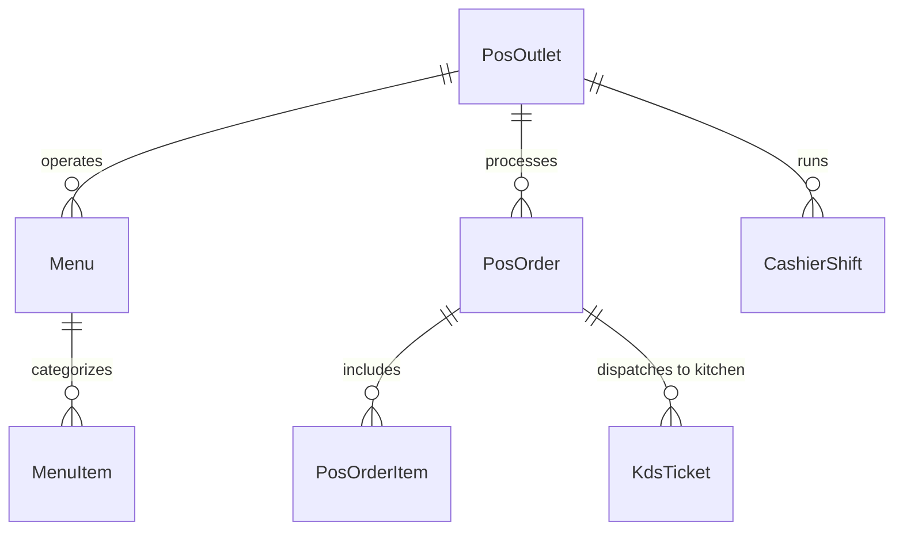

# Restaurant, Bar & Retail Point of Sale (POS) Domain Model

## 1. Bounded Context Overview

The **POS Domain** (`apps/backend/src/domains/pos`) powers high-speed food, beverage, and retail sales across hotel outlets (restaurants, rooftop bars, poolside cafes, gift shops). It features multi-menu management, modifier groups, kitchen display system (KDS) live routing, cashier float drawer balancing, and room-charge guest folio transfers.

---

## 2. Core Domain Rules (`domain/rules/pos.rule.ts`)

### 2.1 Order Total & Taxes
- Calculates line totals, taxes (e.g. 10% VAT / Sales Tax), order-level discounts, and service charges.
- Validates that non-negative quantities and positive pricing apply to all menu items.

### 2.2 Cash Drawer Shift Balancing
- Tracks `openingFloat` (default $500 front-desk/outlet float).
- Compares expected cash in drawer against `closingCash`.
- Categorizes shift outcome:
  - `balanced` (variance == 0)
  - `over` (variance > 0)
  - `short` (variance < 0)

### 2.3 Guest Folio Room Charges
- Validates active booking status (`checked_in`).
- Posts room-charge transaction directly to PMS `GuestFolio` with automatic department tagging (`department: 'restaurant'`).

---

## 3. Repository Contract (`IPosRepository`)

Implemented by `PrismaPosRepository`:
- **Outlets & Menus:** `findOutlets`, `findOutletById`, `findMenus`, `findMenuItems`, `createMenuItem`.
- **Orders & Billing:** `findOrders`, `findOrderById`, `createOrder`, `updateOrder`, `addPayment`.
- **KDS Kitchen Operations:** `findKdsTickets`, `updateKdsTicketStatus`.
- **Cashier Shifts:** `findShifts`, `createShift`, `updateShift`.

---

## 4. API Presentation Endpoints

- `GET /api/v1/pos/outlets` — List all dining and retail outlets
- `POST /api/v1/pos/orders` — Create new POS dine-in/takeaway order
- `POST /api/v1/pos/orders/:id/room-charge` — Bill order directly to guest room folio
- `GET /api/v1/pos/kds/:outletId` — Real-time kitchen display ticket queue
- `POST /api/v1/pos/shifts/open` & `POST /api/v1/pos/shifts/close` — Shift cashier reconciliation
