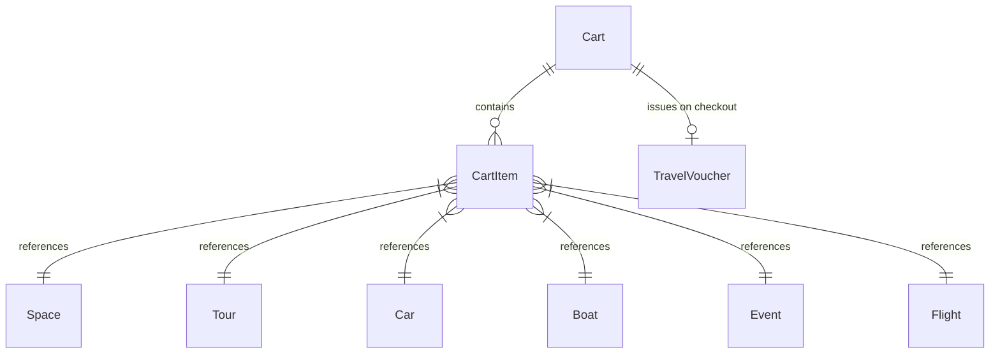

# Multi-Vertical Travel & Universal Cart Domain Model

## 1. Bounded Context Overview

The **Travel Domain** (`apps/backend/src/domains/travel`) delivers multi-vertical travel commerce across 6 verticals:
1. **Coworking & Event Spaces** (`Space`)
2. **Guided Tours & Excursions** (`Tour`)
3. **Car Rentals** (`Car`)
4. **Boat & Yacht Charters** (`Boat`)
5. **Events & Festivals** (`Event`)
6. **Commercial Flights** (`Flight`, `Airline`, `Airport`)

All verticals converge into a **Universal Cross-Vertical Cart (`Cart`)**, allowing travelers to bundle flights, cars, rooms, and tours into a single checkout with automatic vacation bundle discounts.



---

## 2. Core Domain Rules (`domain/rules/travel.rule.ts`)

### 2.1 Dynamic Vacation Package Bundling
- **2 Distinct Verticals** (e.g. Hotel + Car): **10% Bundle Discount** applied to subtotal.
- **3+ Distinct Verticals** (e.g. Flight + Hotel + Tour): **15% Bundle Discount** applied to subtotal.
- Standard hospitality tax rate (5%) applied to remaining taxable balance.

```typescript
export function calculateCartTotals(items: CartItemInput[]): CartCalculationResult {
  const subtotal = items.reduce((acc, item) => acc + item.unitPrice * item.quantity, 0);
  const uniqueVerticals = Array.from(new Set(items.map((i) => i.vertical)));
  
  let bundleDiscountPercent = 0;
  if (uniqueVerticals.length >= 3) bundleDiscountPercent = 15;
  else if (uniqueVerticals.length === 2) bundleDiscountPercent = 10;
  
  const bundleDiscountAmount = Math.round((subtotal * (bundleDiscountPercent / 100)) * 100) / 100;
  const taxableAmount = Math.max(0, subtotal - bundleDiscountAmount);
  const taxAmount = Math.round((taxableAmount * 0.05) * 100) / 100;
  const grandTotal = Math.round((taxableAmount + taxAmount) * 100) / 100;

  return { itemCount: items.length, distinctVerticalCount: uniqueVerticals.length, subtotal, bundleDiscountPercent, bundleDiscountAmount, taxAmount, grandTotal };
}
```

### 2.2 Vehicle & Vessel Rental Durations
- Computes duration in full 24-hour days: `days = max(1, ceil((dropoff - pickup) / (1000 * 60 * 60 * 24)))`.
- Enforces strict invariant: `dropoffDate > pickupDate`.

### 2.3 Cryptographic Travel Vouchers
- Generates HMAC-SHA256 signed travel voucher codes (`VCH-XXXXXXXX-SIG`) downloadable as digital PDFs or verifiable via QR code.

---

## 3. Repository Contract (`ITravelRepository`)

Implemented by `PrismaTravelRepository`:
- **Cart:** `findCartBySession`, `createCart`, `updateCart`, `createCartItem`, `updateCartItem`, `deleteCartItem`, `clearCartItems`, `createTravelVoucher`.
- **Spaces & Tours:** `findSpaces`, `createSpaceBooking`, `findTours`, `createTourBooking`.
- **Vehicles:** `findCars`, `createCarBooking`, `findBoats`, `createBoatBooking`.
- **Events & Flights:** `findEvents`, `createEventBooking`, `findAirports`, `upsertAirport`, `findFlights`, `createFlightBooking`.

---

## 4. API Presentation Endpoints

- `GET /api/v1/cart?sessionId=...` — View current cart summary and bundle savings
- `POST /api/v1/cart/items` — Add vertical item to cross-vertical cart
- `DELETE /api/v1/cart/items/:itemId` — Remove item from cart
- `POST /api/v1/cart/checkout` — Universal itinerary checkout and voucher generation
